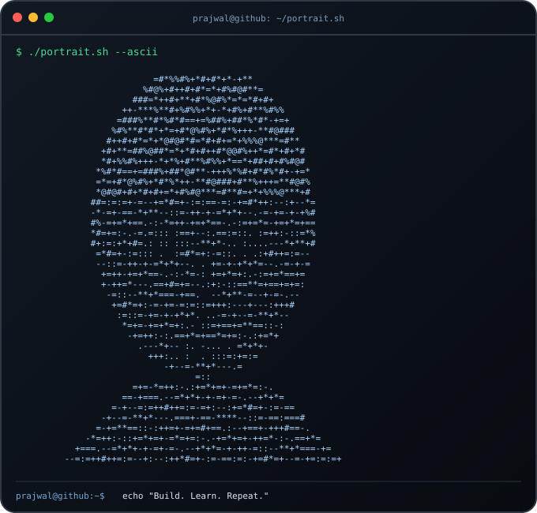
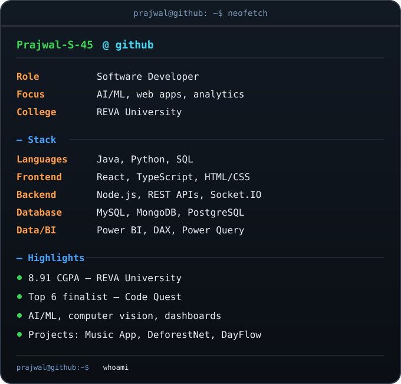

  

# Hi there 👋, I'm Prajwal Angadi

<!-- TERMINAL PROFILE CARDS -->
<table>
  <tr>
    <td width="50%" valign="top">
      
    </td>
    <td width="50%" valign="top">
      
    </td>
  </tr>
</table>

---

<!-- ABOUT & MEDIA SECTION -->
<!-- ================= ABOUT ME ================= -->

<h2 align="center">🚀 About Me</h2>

<table width="100%" border="0">
<tr>
<td width="40%" valign="top" style="border: none; background: none;">

### 👨‍💻 Who am I?

* 🎓 **B.Tech in Computer Science (2023–2027)** • Reva University
* 💻 **Full Stack & Backend Developer** passionate about building scalable applications and AI-powered solutions.
* 🚀 Currently building production-ready software using modern backend technologies and cloud infrastructure.
* 🌱 Currently learning **System Design, AWS, Kubernetes, AI Agents, LLM Engineering, and High Performance Backend Systems.**
* 📹 Tech Content Creator sharing development resources and programming knowledge.

<blockquote>
  

    <i>"I don't just write code. I build scalable solutions that solve real-world problems."</i>
  

</blockquote>

</td>

<td width="60%" align="center" valign="middle" style="border: none; background: none;">

</td>
</tr>
</table>

## 🧰 Technical Skills

<table>
  <tr>
    <td width="50%" valign="top">
      <h3>💻 Languages</h3>
      
      <h3>🎨 Frontend</h3>
      
      <h3>⚙️ Backend & APIs</h3>
      
      
REST APIs · JWT authentication · Socket.IO

      <h3>🗄️ Databases</h3>
      
    </td>
    <td width="50%" valign="top">
      <h3>📊 Data & Business Intelligence</h3>
      
 

      
DAX · Power Query · Dashboard Design · Data Analysis

      <h3>🤖 AI & Computer Vision</h3>
      
Python · TensorFlow · Image Analysis · Satellite Imagery · AI-powered applications

      <h3>🛠️ Tools & Platforms</h3>
      
    </td>
  </tr>
</table>

---

## 🚀 Featured Projects

<table>
  <tr>
    <td width="50%" valign="top">
      <h3>🎧 <a href="https://github.com/Prajwal-S-45/Music-app">Music Streaming Application</a></h3>
      A music streaming web application with song search, artist and album discovery, playback, playlists, liked songs, and synchronized listening features.
        
      <strong>Tech:</strong> 
      <code>React</code> <code>Node.js</code> <code>MySQL</code> <code>JWT</code> <code>Socket.IO</code> <code>JioSaavn API</code>
    </td>
    <td width="50%" valign="top">
      <h3>🌳 <a href="https://github.com/Prajwal-S-45/DeforestNet">DeforestNet</a></h3>
      AI-based deforestation monitoring using Sentinel-1 SAR and Sentinel-2 optical satellite imagery, with severity alerts and geospatial hotspot visualization.
        
      <strong>Tech:</strong> 
      <code>Python</code> <code>TensorFlow</code> <code>Computer Vision</code> <code>Satellite Data</code> <code>SQLite</code>
    </td>
  </tr>
  <tr>
    <td width="50%" valign="top">
      <h3>🧑‍💼 <a href="https://github.com/Prajwal-S-45/Dayflow---Human-Resource-Management-System-">DayFlow — HR Management</a></h3>
      Human resource management system covering employee records, attendance, leave approvals, payroll, role-based access, and payslips.
        
      <strong>Tech:</strong> 
      <code>React</code> <code>TypeScript</code> <code>Supabase</code> <code>PostgreSQL</code> <code>Recharts</code>
    </td>
    <td width="50%" valign="top">
      <h3>🛒 <a href="https://github.com/Prajwal-S-45/Multi-Vendor-E-Commerce-Platform">Multi-Vendor E-Commerce</a></h3>
      E-commerce application for customer, vendor, and admin workflows, including product management, cart, wishlist, and order management.
        
      <strong>Tech:</strong> 
      <code>Java</code> <code>Spring Boot</code> <code>React</code> <code>MySQL</code> <code>Spring Security</code> <code>JWT</code>
    </td>
  </tr>
</table>

### 📊 Data Analytics
**[Power BI Dashboards](https://github.com/Prajwal-S-45/PowerBI_DashBoards)** — analytics dashboards including Spotify and other data-analysis projects.

---

## 🏅 Achievements

- 🏆 **Top 6 Finalist** — Code Quest, REVA University
- 💡 Participant — Adobe University Hackathon 2026
- 🤖 Participant — Amazon ML Challenge 2026

## 📜 Certifications & Learning

- React JS Development — Scaler
- Google Code Vipassana — Seasons 13 & 14
- Google AI Professional Certificate — Coursera
- MongoDB badges — GeeksforGeeks
- Power BI & Data Analytics — Skill Development
- Google Skill Badges

---

## 📈 GitHub Activity

  
  

  

  

<h3 align="center">🐍 Contribution Snake</h3>

  

---

## 🤝 Let's Connect

  
  
  

  

<i>Build with curiosity. Learn by doing. Improve with every iteration.</i>

